# June 19: Get components (1hr 28m)

Kind of want to start with a prototype
components:

- touchscreen
- xiao esp32 (mcu & internet)
- camera module (not built-in, want to customize the position in final phone)

I want to wire everything together/breadboard it
and then I can work on the software/whatever website API thing I'll build that looks like the slap.com
| some inspo |
| -- |
|  |

what I'll buy now:
| item | purpose | cost |
| -- | -- | -- |
| [Hosyond 2.8" 240x320 IPS Capacitive Touch Screen](https://www.amazon.com/Hosyond-240x320-Capacitive-ILI9341V-Mega2560/dp/B0CMGF4Q68/ref=sr_1_4_sspa?crid=1XAGBEJ69NWKT&keywords=hoysound%2Blcd&qid=1781877174&sprefix=%2Caps%2C289&sr=8-4-spons&sp_csd=d2lkZ2V0TmFtZT1zcF9tdGY&th=1) | touch screen, not the built in circuit board one | $16.99 |
| [Seeed Studio XIAO ESP32S3 Sense Camera Sensor ESP32 S3 Dev Board](https://www.aliexpress.us/item/3256810060131517.html?spm=a2g0o.productlist.main.3.26c97W2u7W2uRJ&algo_pvid=9600b499-bb27-4ffa-8288-06fe5e6a5301&algo_exp_id=9600b499-bb27-4ffa-8288-06fe5e6a5301-2&pdp_ext_f=%7B%22order%22%3A%22139%22%2C%22eval%22%3A%221%22%2C%22fromPage%22%3A%22search%22%7D&pdp_npi=6%40dis%21USD%2176.25%2120.95%21%21%2176.25%2120.95%21%40210328d417818773112274592edf68%2112000051668143429%21sea%21US%217544465919%21ABX%211%210%21n_tag%3A-29910%3Bd%3Ae058c3f9%3Bm03_new_user%3A-29895%3BpisId%3A5000000207262906&curPageLogUid=YEOo9tZLpkHo&utparam-url=scene%3Asearch%7Cquery_from%3A%7Cx_object_id%3A1005010246446269%7C_p_origin_prod%3A) | camera module, MCU, wifi capabilities | $20.95 |

I'll order these two parts, connect them physically, figure out the wifi and connect to websites
Then start building the slap website

claude's advice

Breadboard wiring:

- XIAO ESP32-S3 Sense → breadboard, power via USB-C
- Hosyond display → jumper wires from its 14-pin header to XIAO's SPI pins (CS, DC, RESET, MOSI, SCK, MISO) + touch I2C pins
- Camera is already attached to the XIAO Sense via its ribbon — no extra wiring needed for that part!

Then for software:

- Get the display showing something basic (Arduino IDE + TFT_eSPI library)
- Get the camera capturing photos (ESP32 camera library, built into Sense board support)
- Add WiFi — connect to your network
- Build your custom web app/API that the XIAO talks to
- Display fetched data on the touchscreen, send photos to your server

# July 12: Schematic for pear-shaped PCB (6hr 20m)
XIAO ESP32 board arrived, wanted to try programming and wiring it up to the touch screen/prototyping.

---

Wiring up

Mount across the center trench so pins don't short and leave wi-fi antenna extending over edge for stable connection

<p align="center">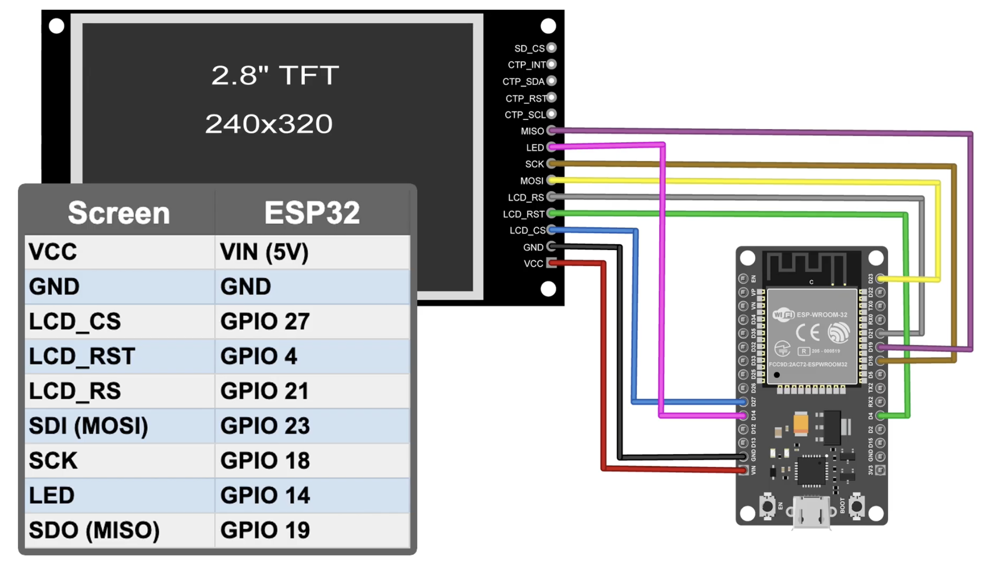</p>

Using ESP32 dev kit as an example

<p align="center">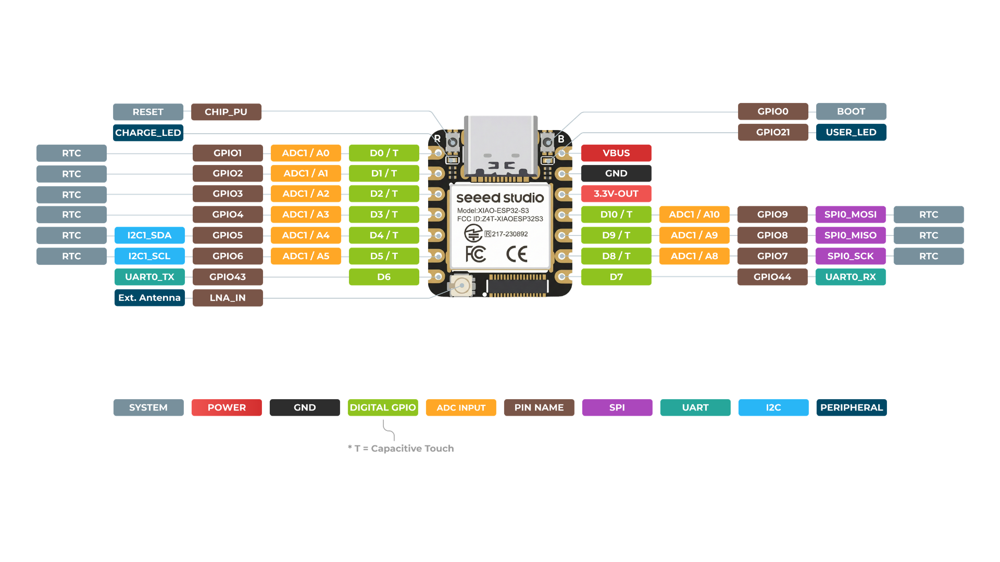</p>

Remapping SCK, MOSI (SDI), and MISO (SDO) to specific GPIO's on S3, other display pins will route to any free GPIOs

| display pin | fx                                               | XIAO S3 pin | Notes                                                                                                   |
| ----------- | ------------------------------------------------ | ----------- | ------------------------------------------------------------------------------------------------------- |
| SCK         | timing signal that synchronizes transfer of data | D8          | serial clock                                                                                            |
| SDI (MOSI)  | data input                                       | D10         | serial digital interface, protocol for transmitting uncompressed & unencrypted digital video over cable |
| SDO (MISO)  | data from peripheral                             | D9          | serial data out                                                                                         |

Remaining pins (free GPIOs)

| display | c3  | fx  |
| ------- | --- | --- |
| LCD_CS  | D6  | ?   |
| LCD_RST | D5  | ?   |
| LCD_RS  | D4  | ?   |
| LED     | D7  | ?   |

This doesn't include the touch screen pins because I need more male to female wires, I'll do that after I buy more. Got more and wired up:

<p align="center">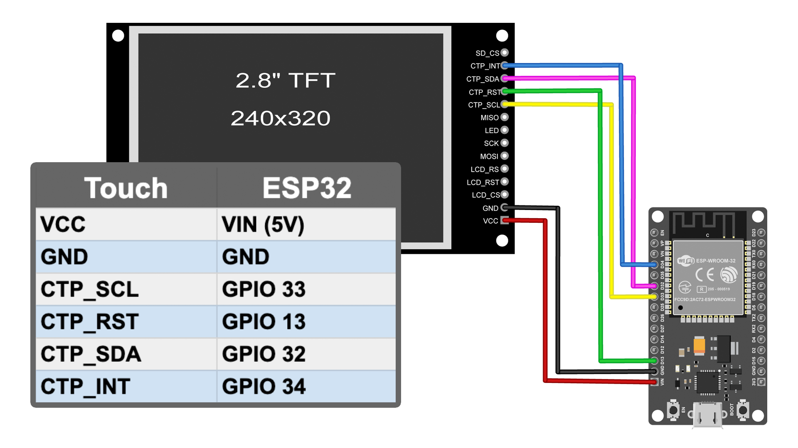</p>

| touch   | esp32 | c3  | fx            |
| ------- | ----- | --- | ------------- |
| CTP_SCL | 33    | 8   | Touch Sensing |
| CTP_RST | 13    | 9   | MISO          |
| CTP_SDA | 32    | ?   | GPIO          |
| CTP_INT | 34    | ?   | input only    |

Oh apparently I can just wire the touch screen pins to any GPIOs.

| touch   | c3  | Notes         |
| ------- | --- | ------------- |
| CTP_SCL | 0   | Touch sensing |
| CTP_RST | 2   | MISO          |
| CTP_SDA | 1   | GPIO          |
| CTP_INT | 3   | Input only    |

I guess SD_CS stays unconnected

Programming

Install ESP32 boots package Version 2

Arduino IDE/Settings/Additional boards manager URL and insert [this link](https://raw.githubusercontent.com/espressif/arduino-esp32/gh-pages/package_esp32_index.json) then tools/board manager, search ESP32 and download version 2.0.4 by espressif. Once downloaded, select tools/board/esp32/XIAO_ESP32C3 (scroll down a lot)

Install LovyanGFX 1.2.19, new tab and create an [lgfx_config.h](/code/c3/lgfx_config.h) file

Run [hello_world.ino](/code/c3/hello_world/hello_world.ino) to print Hello World

It's compiling and uploading fine but not actually printing anything. I checked my wiring. Oh it's because my pinout is mapped to the S3 not the C3, no need to rewire, just update the code.. didn't know D-numbers and GPIO numbers were two separate naming systems.

Change offset_rotation in the config file, 0 for portrait and 3 for landscape.

For more complex UI, use the [advanced library](https://github.com/lvgl/lvgl)

<p align="center">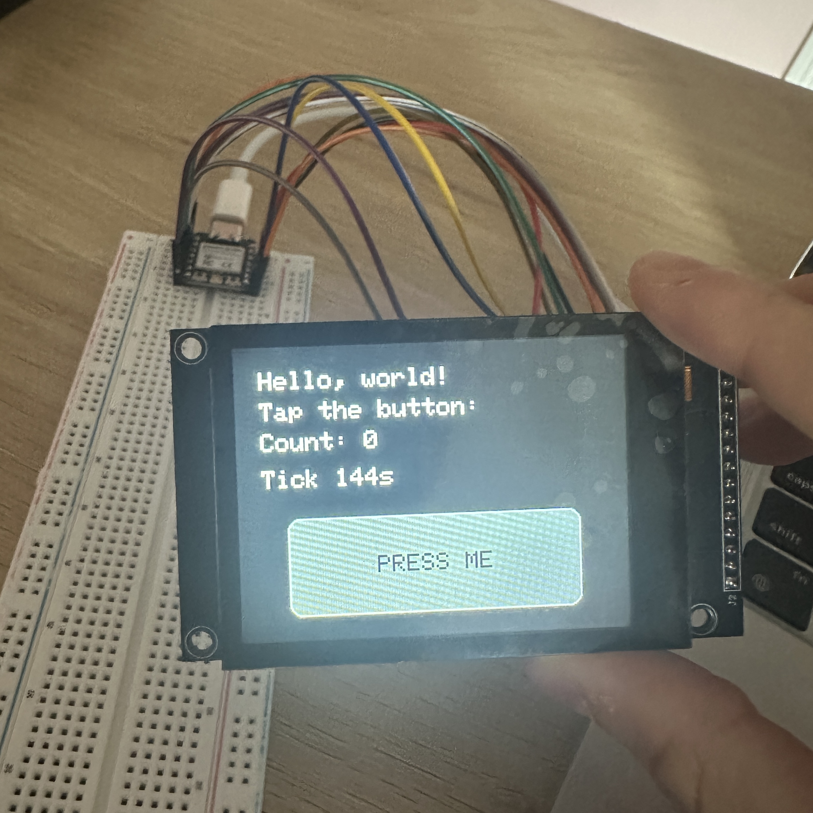</p>

I was like why isn't it registering my taps then realized I still had the plastic sticker on top 🙂‍↕️

Can also import images via microSD card on back of touchscreen.

Going to start making the PCB (copper traces instead of jumper wires now)

Need to import some footprints:

[XIAO ESP32C3](https://www.snapeda.com/parts/XIAO%20ESP32C3/Seeed%20Studio/view-part/?ref=search&t=xiao%20esp32c3&ab_test_case=b)
\*Right now working with the C3 but getting the [S3](https://www.snapeda.com/parts/XIAO%20ESP32S3%20SENSE/Seeed%20Studio/view-part/?ref=search&t=xiao%20esp32s3%20sense&ab_test_case=b) (camera, so will have to update)

Can't find a footprint/symbol for the touchscreen, I'll place a 1x14, 2.54mm pitch female header (or box header) that the module's existing male pin header plugs into instead. See /production/imports

Not sure what type of connector: pin, generic, mounting pin, or generic shield. Pins stick out, generics are the black rectangular housing (probably what I want), supplies electricity, mounting is just structural/doesn't supply electricity, and shield is grounded

This is cool because before I didn't know the D-numbers and GPIO numbers were two separate naming systems but I can see it clearly in the schematic:

<p align="center">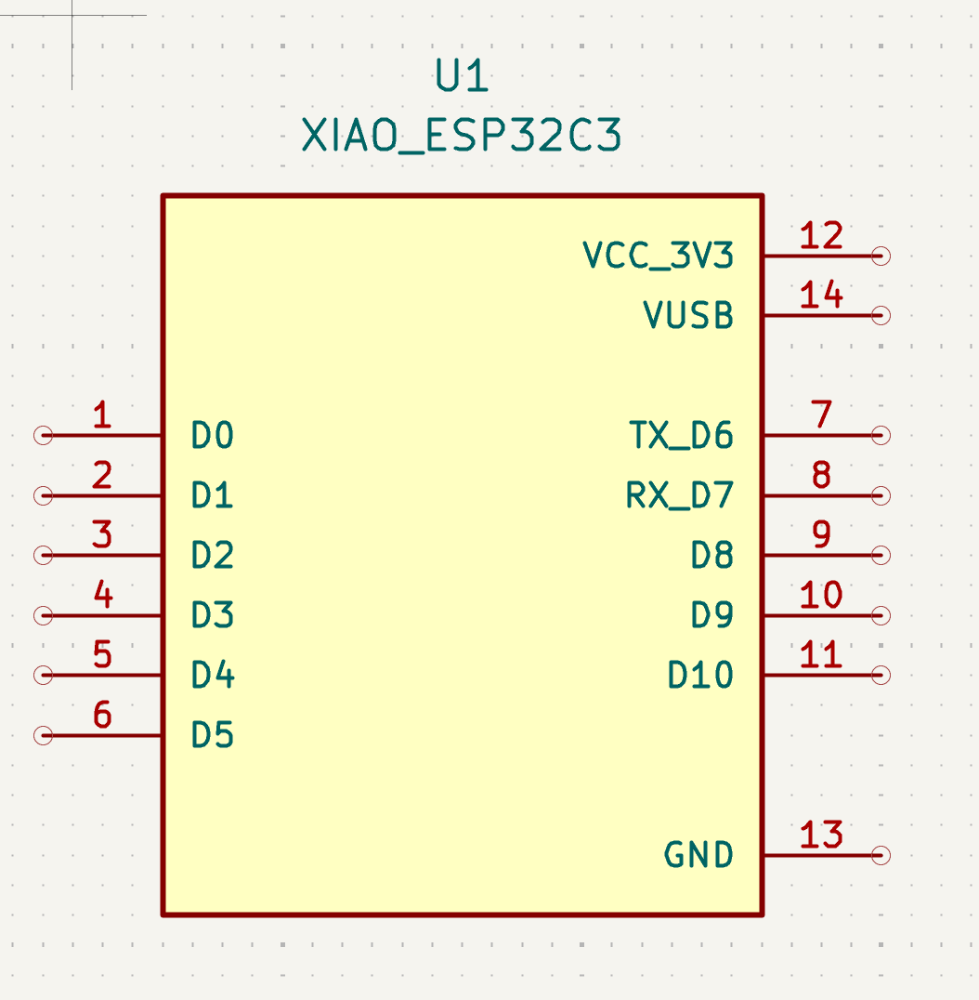</p>

Also if I want to add buttons/switches I'm going to need more pins, so the C3 may have not been the right MCU after all. I'm going to try routing the LED (backlight) to 5V and open up the D7 pin/8, then connect the switch to it. I've attached a power flag to the VUSB and GND pins of the C3 in the schematic (getting power externally) this resolves any "input power pin not driven by any output power pin" errors. This works for power and GND because when you plug into a USB port, you're getting both the supply and the return path from that one connection.

Because I'm adding a switch/push, I'll include in firmware

`pinMode(pin, INPUT_PULLUP)`

Cool, here's the schematic

<p align="center">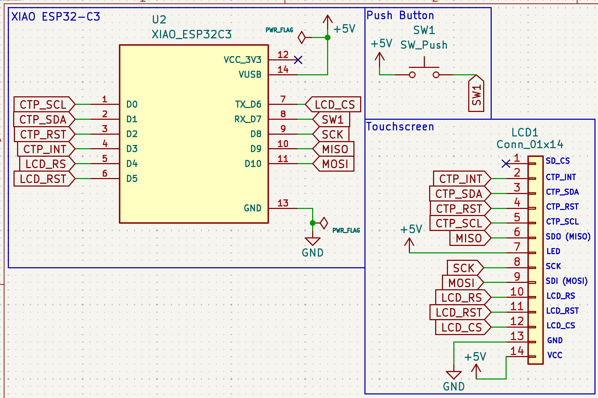</p>

Made the edgecut and pear phone logo /images/onPCB

I'll assign footprints next, I already imported the C3.

I'll use the switch/push buttons in the arduino kit, not sure if that's considered through hole (THT) or surface mount (SMD). I'm pretty sure if I was getting it assembled with the PCB I'd select SMD but because I'm mounting my own I'll go with THT? THT is the right choice, it physically matches the 6mm x 6mm switches I have, and is also easier for less "professional soldering". SMD switches actually look different, with flat pads/gull-wing leads that sit on the board's surface. I'll assign SW_PUSH to SW_PUSH_6mm.

Lastly we'll assign the connector pins to Connector_PinSocket_2.54mm:PinSocket_1x14_P2.54mm_Vertical

Pin socket is for female, pin header is for male, P2.54mm matches the datasheet's "14P 2.54mm spacing Header". I'll choose vertical for now so I can put the touchscreen in landscape but in the next variation I might choose vertical and put it in portrait mode.

Time to PCB!

I need to make sure my edge cuts/PCB's pear shape fits the display nicely. I'll add the pear logo to the back by setting it to B.Silkscreen, I might remake it with a filled in pear instead of the outline. To cut out the PCB I have to import it as a DXF, but first I need to fill in the actual pear shape so I'll quickly do that for both. See /images/onPCB. Cool I'll just make sure the header pins will size the touchscreen correctly, its 1" x 2.8" so 25.4mm x 71.1mm, I'll use the ruler in PCB viewer and make sure it fits on the whole board and on the headers nicely. I'm going to flip the board/pear shape horizontally to look better and make it smaller. I'll wire it up tomorrow.

| PCB                           | front                         | back                          |
| ----------------------------- | ----------------------------- | ----------------------------- |
| 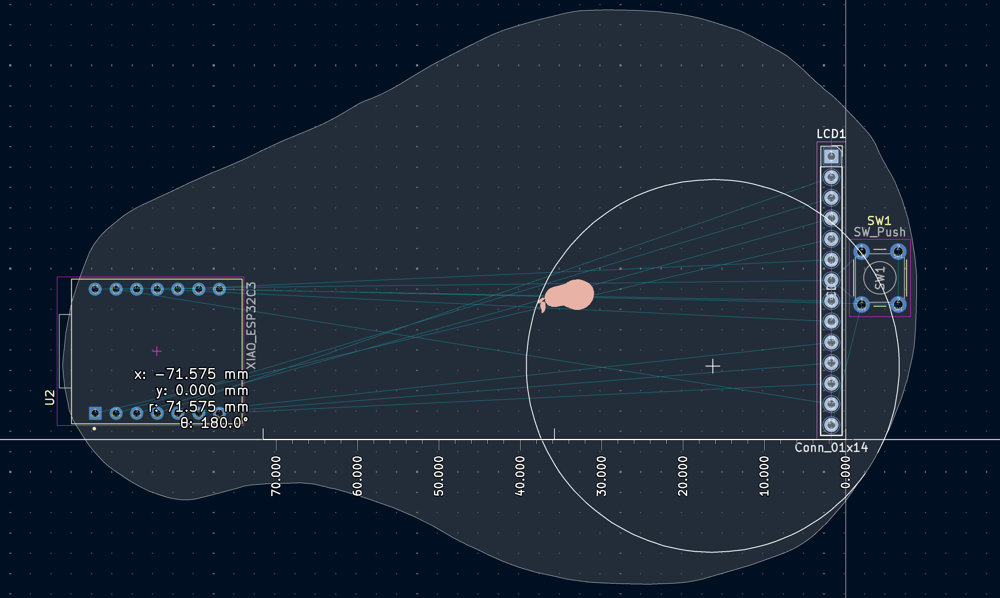 | 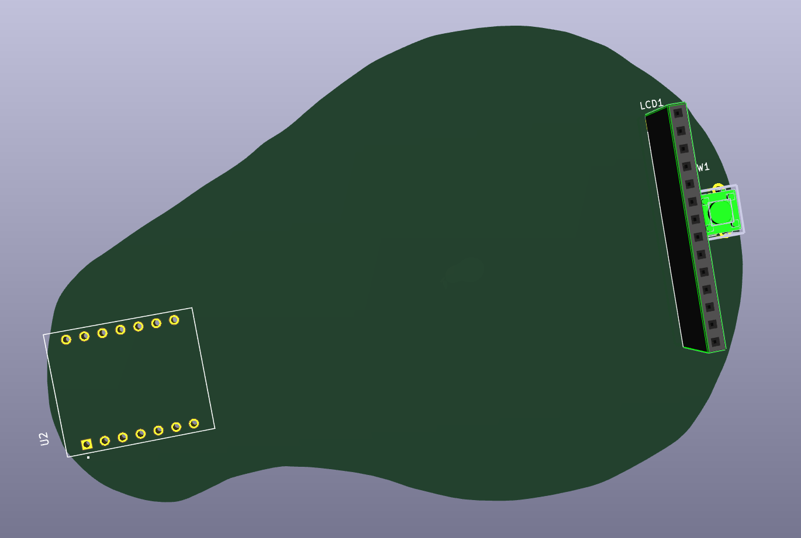 | 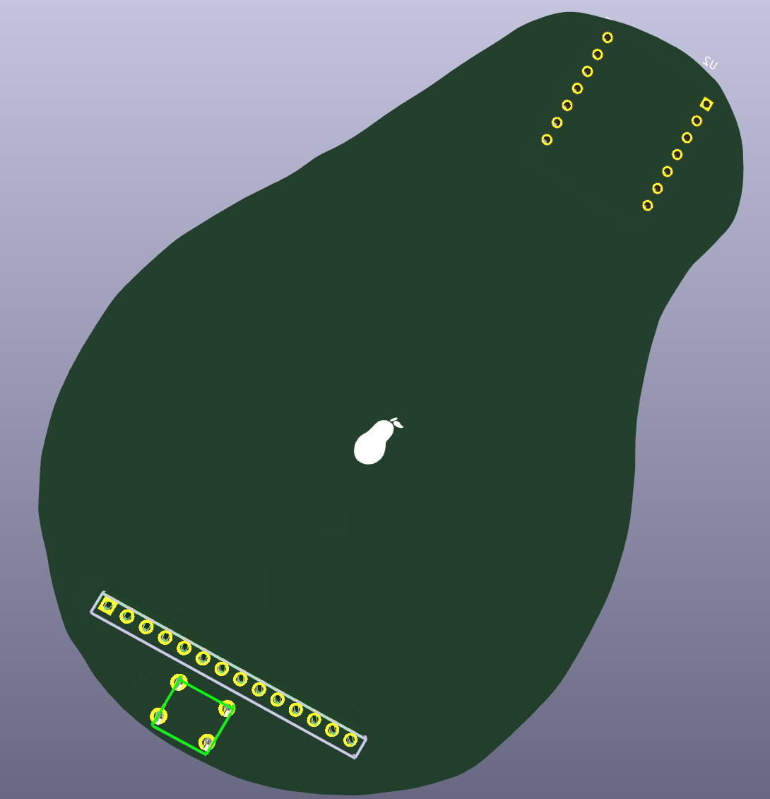 |

# July 13: Wired PCB (1hr 35m)

I'm going to try setting up the wifi server from the C3. I've plugged it in and am trying the WifiServer example sketch and have this [tutorial](https://www.youtube.com/watch?v=aH3sLEQI4_w&t=21s) open. I don't really care about turning on/off the LED, I just want to see if it connects to the web server, I might connect it by toggling on/off the backlight LED of the touchscreen.

I kept trying to upload the WifiServer sketch and it wouldn't work, then remembered the C3 came with another piece that's like a connector, I'll try adding it and running. So it's a Ipex connector connects the WiFi, bluetooth antenna to increase signal strength, so the code should be running without it but it may help to add. Sweet it worked and printed my the C3's IP.

See [wifi_server.ino](/code/c3/wifi_server/wifi_server.ino).

If I want to make an actual website (maybe use [this tumblr website](https://theslapdotgov.tumblr.com/) as a reference) I'll create the website files within the C3 project instead of putting it in another project and directing to its domain. Instead of using a specific IP address I could also look into using mDNS for friendlier links.

# October 18: Playing with GFX (1hr 10m)
# June 19: (2hr 50m)

Time to wire the PCB, I think I'll buy it off of PCBWay because they can do a minimum of 1 PCB, I don't want 5 from JLCPCB. I'm just not sure how they want the fabrication files.

Cool she's wired, no errors, just silkscreen warnings we can ignore and complaints about the footprint I'm pretty sure I resolved before. Let's get it on PCBWay. Wait I kind of want an outlined of the pear shape like what I did on the blinky.. maybe on V2.

<p align="center">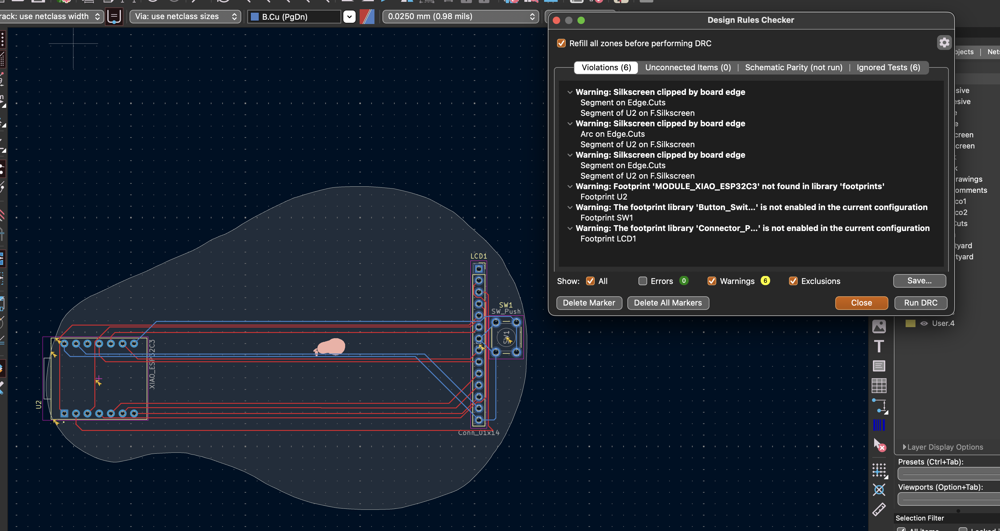</p>

Looks like min quantity on PCBWay is also 5. Back to JLCPCB.

This is the current BOM, the PCB is $7.60 and $11.72 with Global Standard Shipping and taxes

| Id  | Designator | Footprint                       | Quantity | Designation  | Supplier and ref |
| --- | ---------- | ------------------------------- | -------- | ------------ | ---------------- |
| 1   | LCD1       | PinSocket_1x14_P2.54mm_Vertical | 1        | Conn_01x14   |                  |
| 2   | SW1        | SW_PUSH_6mm                     | 1        | SW_Push      |                  |
| 3   | U2         | MODULE_XIAO_ESP32C3             | 1        | XIAO_ESP32C3 |                  |

I remember having to edit some of the column names for the devboard, hopefully I didn't have to do that for this/KiCad's BOM will work directly, especially if I'm not asking them to assemble anything.

# October 20: Choosing new screen component (5m)
Want to go with a different screen, the current touchscreen can only render screenshots and I'm not able to get the touchscreen to register my taps. Instead I'll go with a Sunton 4.3" / 7" ESP32-S3, for gyroscope and add an MPU6050 or BMI270 breakout over I2C.

# October 31: Fixing case design (3hr 15m)

<p align="center">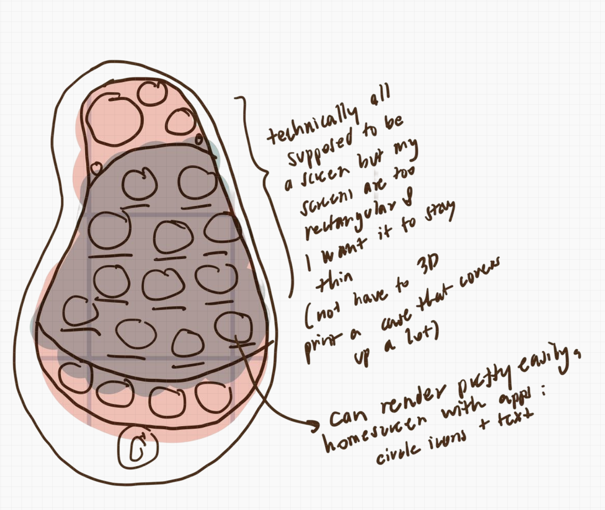</p>

It's really hard to find screens that aren't a rectangular shape (other than those cicrcular ones everyone on youtube is turning into a hair pin), or I should specify, screens that are unconventional or custom shapes (like pears), nevermind touchscreens. So I kept trying to think of ways to cover up the rectangular shape of the screen with the case I'll design for the phone, and I came up with this new design, where I'll just have more parts of the case extruding on top of the screen, like more buttons.

<p align="center">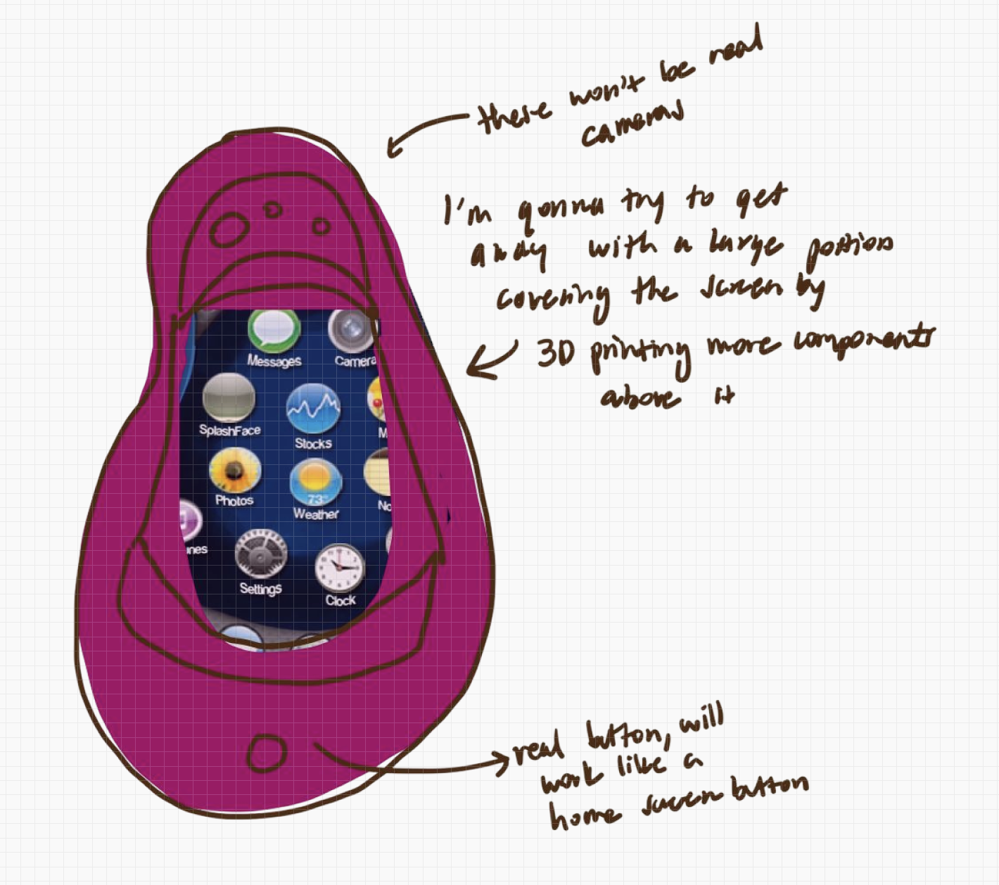</p>

For the UI, I like the "home screen" appearance for the general phone, with all the apps in the background, although I don't think I will make these functional, I they'll give the project the appearance of a phone.

<p align="center">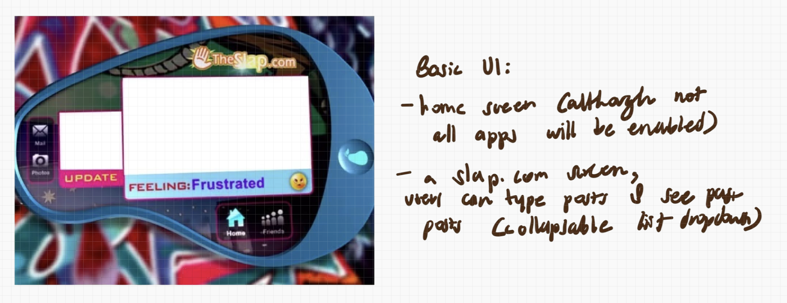</p>

I do want to make the posting to the slap.com feature come to life, although it will definitely just be a local. Plan is, I'll make the slap.com the only functional app on the phone. Users can tap on it, then are taken to a screen with their own profile, and collapsable sections with their past notes. Depending on the capabilities of LGFX, I'll decide what these notes look like, either:
+ Writing real posts (a keyboard shows up and users can easily type)
+ Users draw within a small white board space
+ Users select an emoji

Then, they can return to the home screen by clicking the home screen/pear button, or turn it off by clicking the off button.

Also last time I tested it, the touchscreen aspect was not working. I might just try with regular ESP32s (I'll need to get, but I will probably need them in the future anyways) instead of the Seeeduino C3.

I'll measure the touchscreen dimensions so I can design the case more accurately.

<p align="center">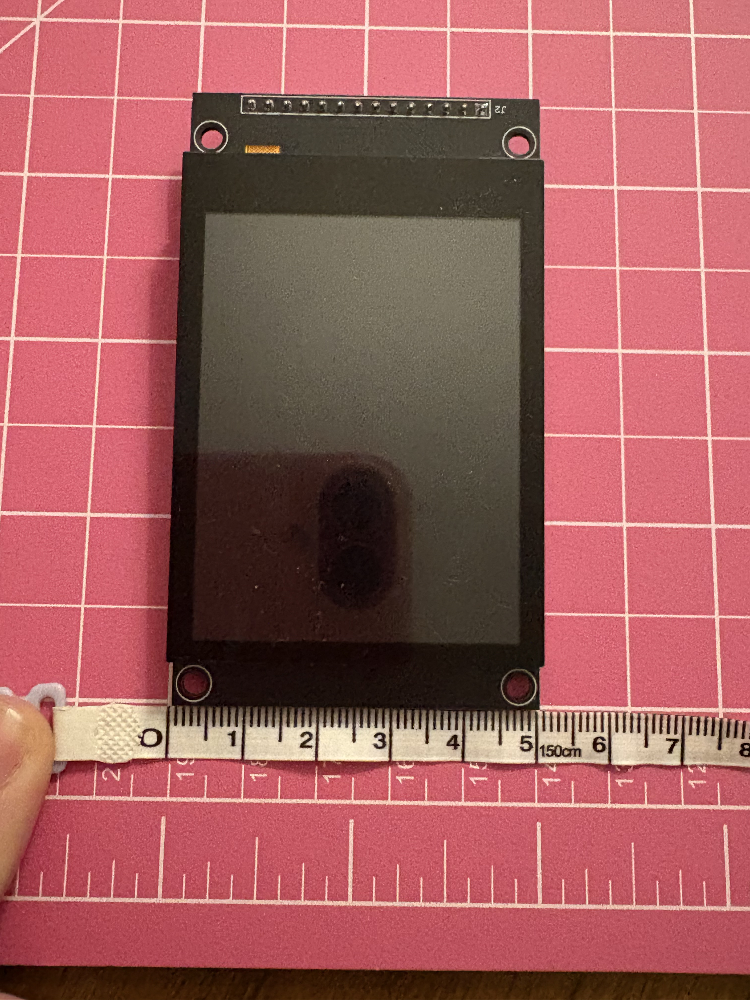</p>

<p align="center">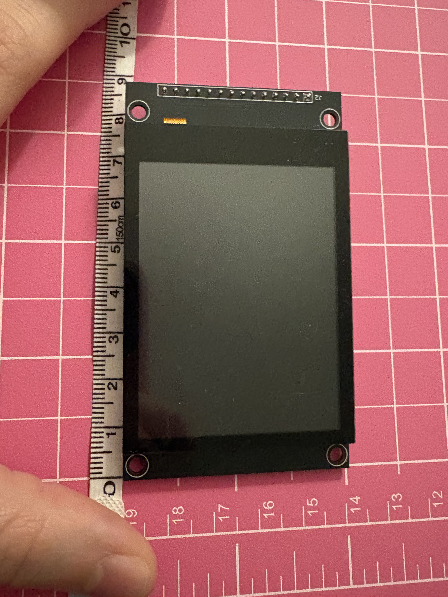</p>

<br>

I got about ```5 x 9.75 mm``` for the whole component, the product description gives ```49.56 x 74.04 mm``` for the visual area.

I'll start designing more precisely.

Future ideas
+ Settings button
Go to settings page where you can change the background color.

Ok, very roughly, it'll look like this:

<p align="center">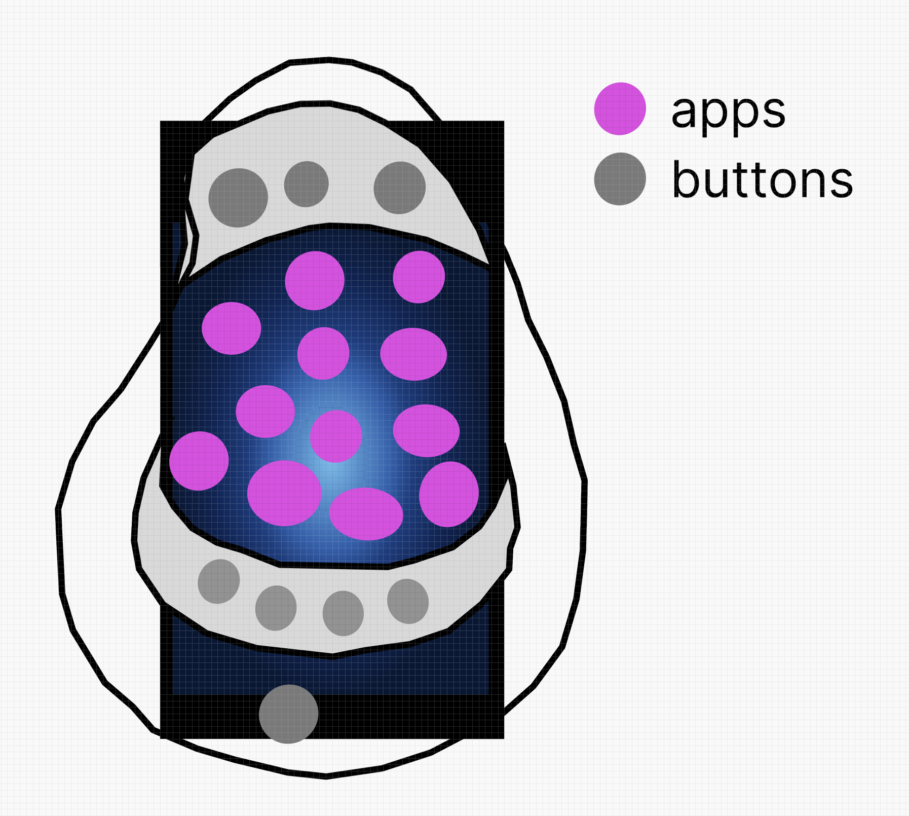</p>

Let's work on the UI for the apps and home screen. I'll model it off the "Piano Black" pear phone and make a design reference for Claude.

<p align="center">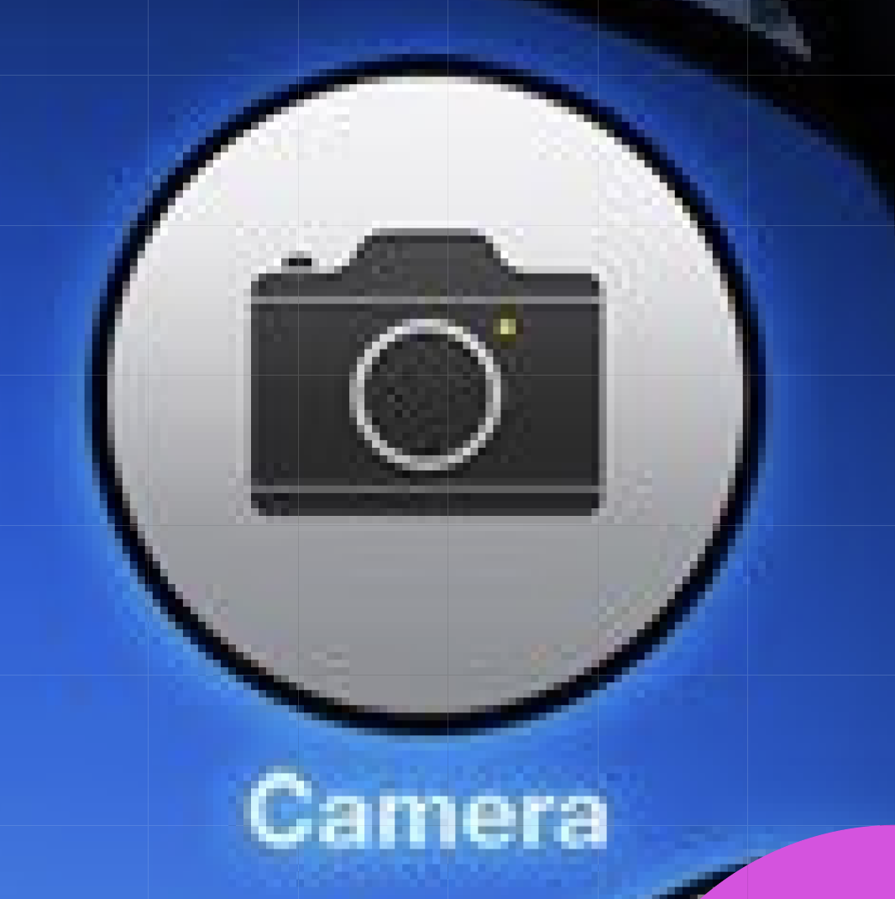</p>

The apps are just circles with black outlines, and the icons look like they were taken from Apple. They also have a light/glowing text with the name underneath. I'm debating if I make this cutesy and my style or just try to replicate the pearphone exactly. Yeah I'm making it cute.

I'll use the crusty 2014 app icons but make the background pink, the sides white & pink polkadots, and the back a pink version of Tori's make it shine locker, with these inspo images:

<p align="center">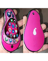 </p>

Touch screen apps: mesages, camera, slapface, stocks, maps, photos, weather, notes, peartunes, settings, clock, videos

I'll make them in Canva (I <3 Canva tuff club) 

# November 1: Working on touchscreen UI (4 hours)

The fonts Victorious uses are: bank gothic, orbitron & average sans
I'm downloading them and importing them into Figma right now (had to get the app)

I got the actual emojis from Victorious and upscaled them (thank you again Canva tuff club)

<p align="center">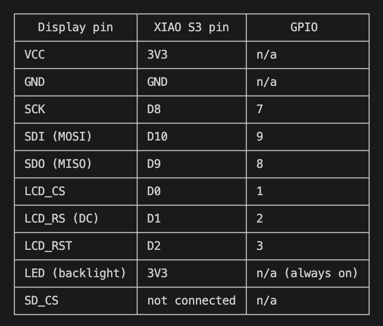</p>

I'll wire up to the computer and start uploading the UI. Currently using the C3 for the [s'mores pad](https://github.com/emilyahmad/smores-pad), a custom s'mores-themed macropad I made. I'l stick with the display for now instead of adding the touch (although I should wire up the touch soon because I was having issues with it not responding with the C3).

I [tested](/code/s3/XIAO_sanity_test/XIAO_sanity_test.ino) the XIAO's working (without soldering headerpins)

<p align="center">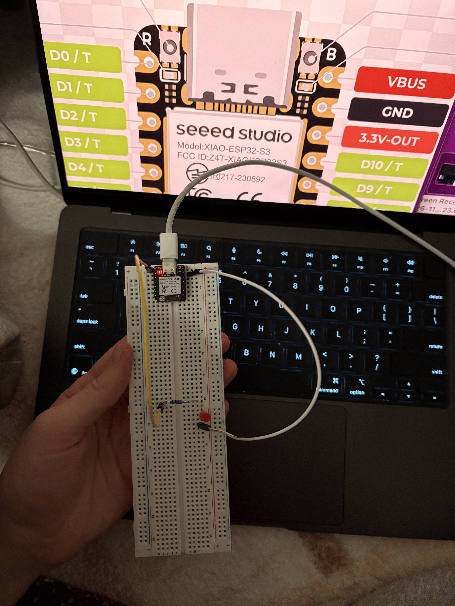</p>

It's struggling to pick up the touch screen, so I'll solder on the header pins. LED test and looks good.<br><br>

<p align="center">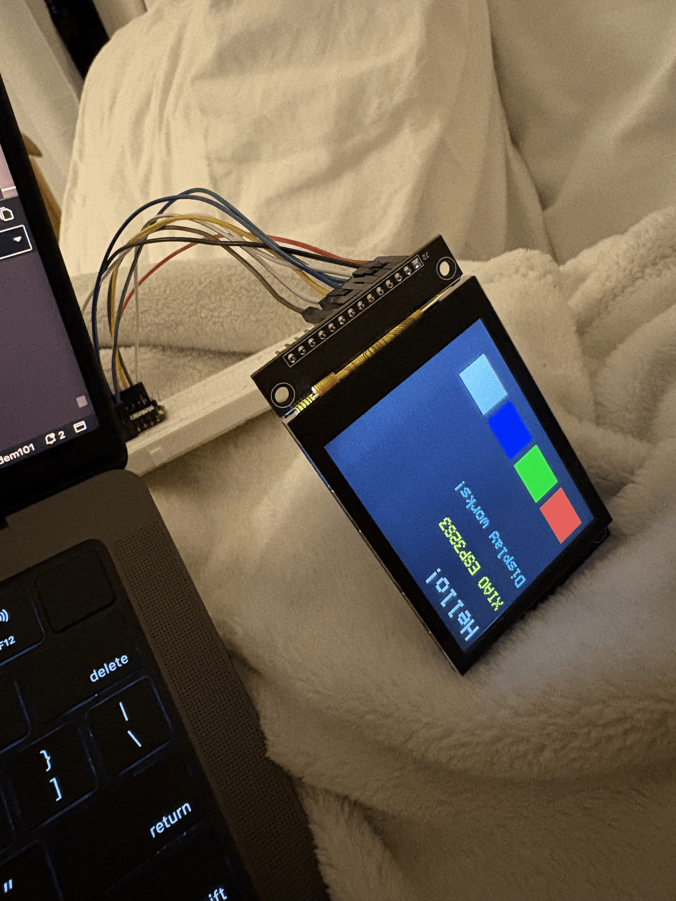</p>

Sweet touch screen lights up right, I also downloaded Adafruit_ILI9341 from library manager.

<div align="center">
<table>
  <tr>
    <td align="center" valign="top">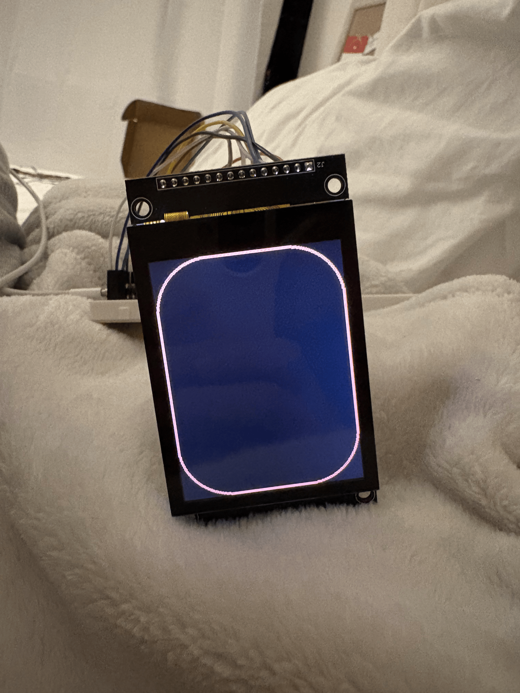<br><sub>Rounded-corner outline of the visible area</sub></td>
    <td align="center" valign="top">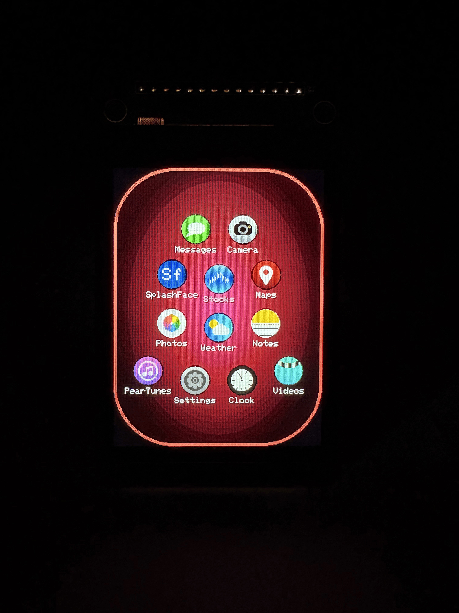<br><sub>Home screen with the app icons</sub></td>
    <td align="center" valign="top">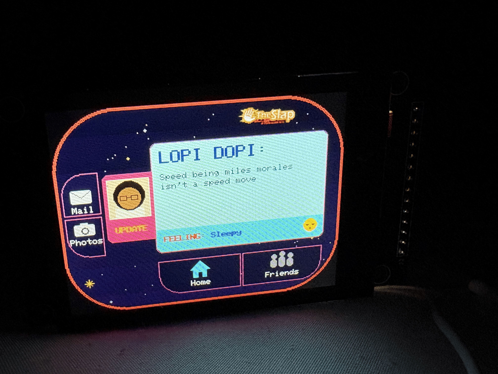<br><sub>TheSlap profile page</sub></td>
  </tr>
</table>
</div>

Outline what will actually be displayed (the pear shaping case will cover the corners)

# November 2: Wiring touch screen (3 hours)

I'll wire up the touch sensors.

<p align="center">
  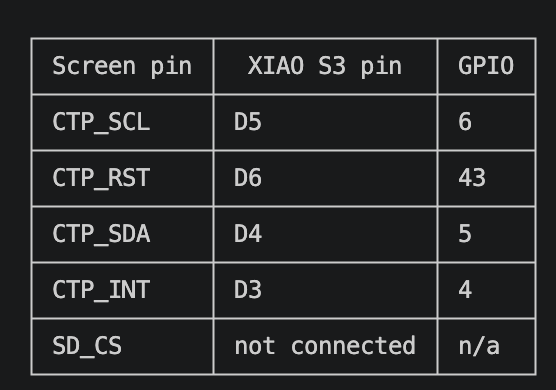<br>
  <sub>Wired up the touchscreen, now I'll run some code eto test it.</sub>
</p>

Yay she works, see the test [code](/code/s3/tests/touch-test.ino)

<p align="center">
  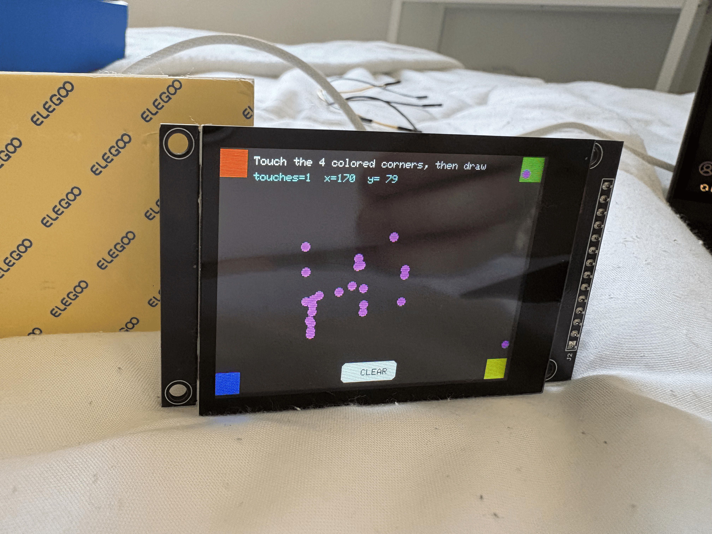<br>
  <sub>Freehand drawing and corners work (although the pear case will likely cover the corners</sub>
</p>
<br>

I'm now uploading this sketchfolder: [phone.ino](/code/UI/phone/phone.ino), [home_screen.h](/code/UI/phone/home_screen.h) and [slap_screen.h](/code/UI/phone/slap_screen.h)

<p align="center">
  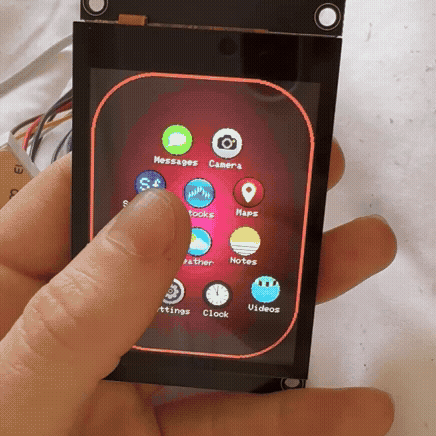<br>
  <sub>Pressing the SlapFace app opens theslap.com page</sub>
</p>

I'll work on developing a more advanced UI, starting with the Slap.com screen. The goal is to have users be able to post messages with an emoji/feeling like in the show. They can either post something new or view old posts in a collapsable manner.

<table align="center">
  <tr>
    <td align="center" valign="top" width="50%">
      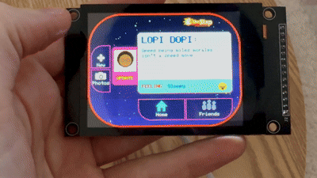<br>
      <sub>Editing message</sub>
    </td>
    <td align="center" valign="top" width="50%">
      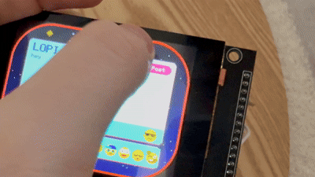<br>
      <sub>Posting</sub>
    </td>
  </tr>
</table>

Users can update their current message and select an animated emoji. Some changes I want to make:
+ Move "New" and "Photos" and their icons to be better centered within their tab
+ Back and Post buttons are not always responsive
<table align="center">
  <tr>
    <td align="center" valign="top" width="50%">
      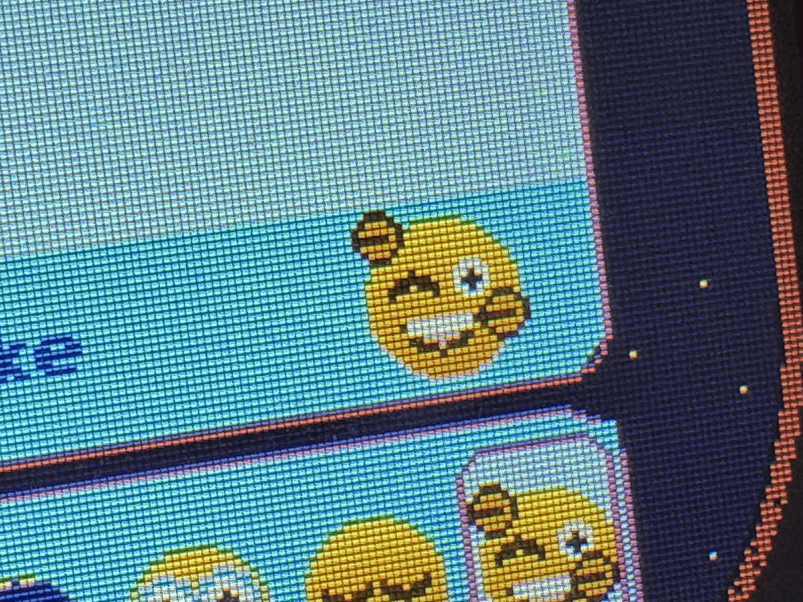<br>
      <sub>Weird electron shape instead of hands</sub>
    </td>
    <td align="center" valign="top" width="50%">
      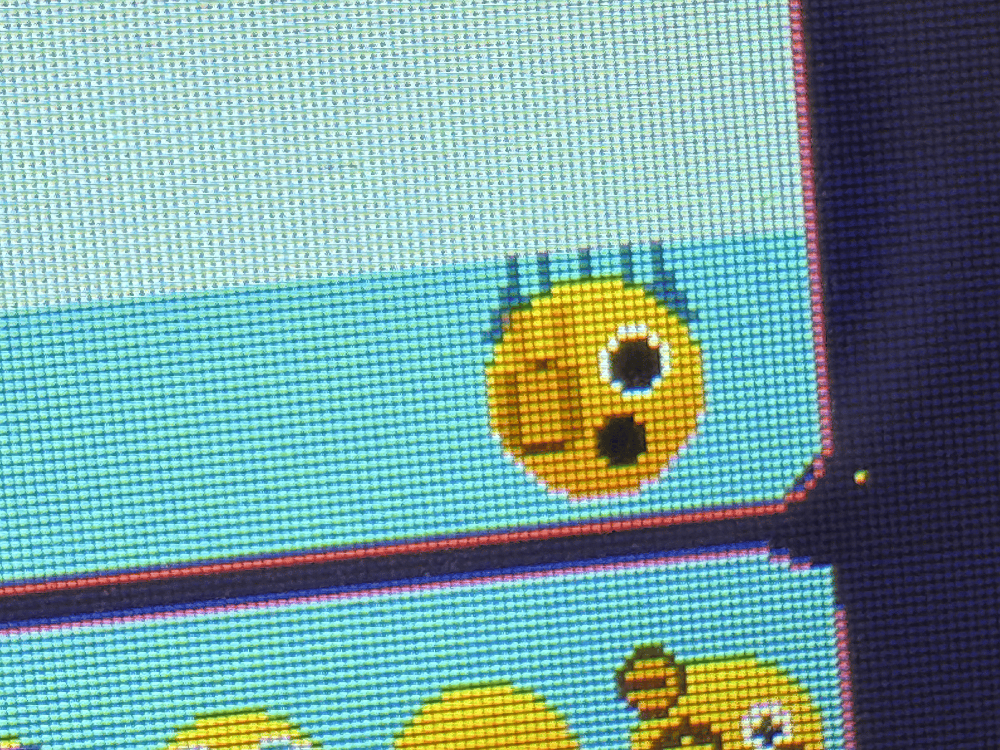<br>
      <sub>Preferable hand example</sub>
    </td>
  </tr>
</table>

+ Make the "Super pumped" and "Fighting to stay awake" emojis better by replacing the electron looking circles with something that looks more like hand - the Rock n Roll one is a pretty nice example
+ Make the message text bigger

Idea for later:

Power switch + rechargable module + lipo battery would be nice. Oh this XIAO is rechargable. I'll just get a 
+ 3.7 V single-cell LiPo, with a built-in protection circuit (PCM), 500–1000 mAh
+ small SPDT slide switch (e.g. SS12D00 through-hole)
+ 2 × 100 kΩ resistors, divides voltage so we can read battery life

# November 3: Adding username, choosing avatar (phone booting) (2 hours)

In portrait mode (how the home screen is oriented), when users turn on the pear phone for the first time, I want them to see a "hello" screen drawn out (like the iPhone does)

<br>

<p align="center">
  <br>
</p>

Then, it'll prompt them to enter a name and design their avatar, these will show up again in the Slap.com app. I think I'll slightly grey out the other apps to give the appearance that they aren't functional - like the friends tab in the slap.com screen, and then if I work on this in the future I'll return them to their original color (I can just grab from a previous commit).

I'll also create a settings screen with a sign out button so new "users" can use the phone with their information.

# November 4: Finishing UI touches

I'll add some more touches,
including touching up some of the emojis and their animations, especially the ones with the little hands.
When users first plug in their device, they get a black screen with a lightning bolt drawn in the center indicating power was received.
I've also adjusted the sizes of the home and friends tabs so the icons & text are the same as the new/clear, the width still matches the message box but the height is also the same as the other's